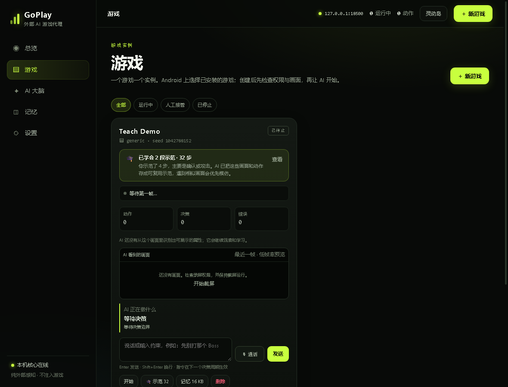
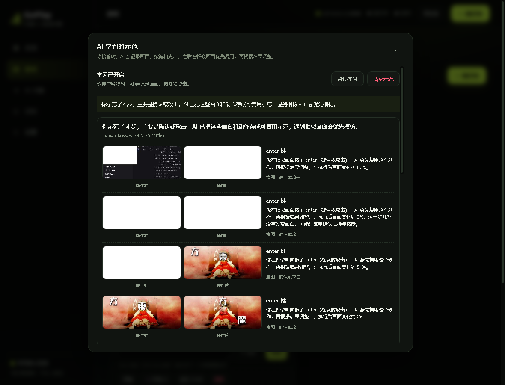

# GoPlay Desktop（跨平台桌面壳）

GoPlay 桌面版是一个**原生窗口 + 内嵌 Web 面板 + 同进程 daemon**的轻量客户端。它不是把 Web 页面塞进浏览器标签，而是用系统 WebView 提供独立窗口；关闭窗口即停止自动游玩、保存记忆并退出。

## 1. 运行

```powershell
# 构建
go build -o bin/goplay-desktop.exe ./cmd/goplay-desktop

# 运行
.\bin\goplay-desktop.exe
```

首次启动会在数据目录创建 `config.json`、`desktop.log` 和实例记忆目录。默认数据目录是 `%LOCALAPPDATA%\GoPlay`，默认地址是 `127.0.0.1:8420`。

常用参数：

| 参数 | 说明 |
|---|---|
| `-data DIR` | 数据目录；同时读取该目录下的 `config.json` |
| `-config FILE` | 显式配置文件 |
| `-addr HOST:PORT` | 监听地址；默认 127.0.0.1:8420 |
| `-llm auto/api/local/offline` | 覆盖 LLM 模式 |
| `-browser` | 不使用原生窗口，改用系统浏览器 |
| `-width` / `-height` | 初始窗口尺寸（默认 1180×780，最小 880×580） |
| `-v` | 调试日志 |
| `-version` | 打印版本并退出 |

## 2. 平台依赖

| 平台 | 窗口后端 | 构建依赖 |
|---|---|---|
| Windows 10/11 | WebView2（Edge Chromium） | Go + CGO + WebView2 Runtime；Windows 11 通常自带 |
| macOS 12+ | 系统 WebKit | Xcode Command Line Tools |
| Linux | WebKitGTK | `libgtk-3-dev`、`libwebkit2gtk-4.0-dev`、`pkg-config` |

如果 Windows 没有 WebView2 Runtime，程序会显示可读的错误页；可安装 Evergreen Runtime，或改用 `-browser`。完全无 GUI 环境请使用 `goplayd`。

Windows 高 DPI（125%/150%/200%）下，桌面壳使用 `third_party/webview_go` 的 raw-pixel bounds 补丁，并在窗口上屏后按真实 DPI 重设尺寸、把窗口移回显示器工作区，避免 WebView 按 DIP 渲染导致右侧/底部被裁切。`move` 为 Windows 专用；macOS/Linux 继续使用系统窗口默认行为。

## 3. 启动流程

1. 读取配置并计算面板地址。
2. 如果该地址已有 GoPlay daemon（`/api/health` 返回 `service: goplay`），直接连接，不重复启动。
3. 否则先显示启动页，在后台 `service.Start`：绑定端口、初始化本地模型、实例管理、HTTP/WS。
4. 面板就绪后导航到内嵌页面；失败则显示错误页并写 `desktop.log`。
5. 关闭窗口：取消上下文，等待启动协程，停止实例与本地 llama-server，保存记忆。

端口被非 GoPlay 程序占用时，会自动改用 `127.0.0.1:0` 的临时端口；使用显式 `-addr` 时不会自动改端口，便于固定书签/手机连接。

## 4. 原生绑定

面板右上角的“数据目录”和“退出”按钮通过 `window.goplayDesktop(action)` 调用 Go：

| action | 行为 |
|---|---|
| `version` | 返回版本字符串 |
| `data` | 打开数据目录 |
| `overlay` | 启动随包的 `goplay-overlay.exe` 原生无边框置顶浮窗（缺失时回退浏览器 `/overlay`） |
| `quit` | 关闭窗口并正常退出 |

绑定只在桌面壳中存在；普通浏览器打开面板时按钮自动隐藏。

## 5. 与 Web 版/daemon 的关系

- 桌面壳、`goplayd`、`goplay` CLI 共用 `internal/service` 的启动与退出路径，避免“GUI 能跑、daemon 不能跑”的分叉。
- GUI 与 daemon **同进程**；不需要先手动启动 daemon。
- 也可以用 `goplayd` 启动无界面服务，再用浏览器访问；两者数据目录和配置格式一致。
- 桌面壳不改变安全边界：截屏、输入、Lua profile、策略与审计逻辑都在核心中。

### Windows 输入安全（v0.4.4）

- Windows 实例必须绑定 `target_window`（窗口标题子串）。只有该窗口在前台时，核心才会抓屏并发送 SendInput；否则实例进入“等待画面”，**不截屏、不注入**，因此不会把 w/a/s/d 打进聊天窗口、浏览器或桌面。
- 引擎在每次动作成功后调用 `SystemHuman.MarkInjected()`，把这次 SendInput 产生的输入时间戳排除，AI 不会把自己的键鼠误判为人工接管。修复前每个动作后都要等 1.2–2.5 秒人工冷却，表现为“几秒才动一下”。
- 人工接管只在目标游戏窗口前台且检测到真实输入时触发；点 GoPlay 面板、浏览器或其它程序不会暂停游戏实例。
- 当前**不支持**“用户继续用电脑、AI 在同一桌面后台玩”。后台窗口 `PrintWindow` 对 DirectDraw 旧游戏实测只得到标题栏/空白；且 SendInput 只能发到前台窗口。需要同时用电脑时请使用独立 Windows 会话/虚拟机（暂未内置）。

### 通用示范学习（v0.5.0）

- 人工接管时，Windows 端会记录每一次真实按键/点击、操作前画面缩略图、操作后画面、画面变化比例和通用意图（确认/返回/移动/攻击/点击）。
- 一段接管结束后会保存为示范；AI 在相似画面上会先复用那一动作，再按结果调整。没有针对某个游戏写死按键或像素规则。
- 匹配使用 24×14 的 RGB 块签名：同一场景约 0.83，不同画面约 0.59，阈值定为 0.80。每次复用有 1.2 秒冷却，避免同一帧无限重复。
- 实测：在真实 `th06c.exe` 上由外部脚本扮演人完成 32 步示范，随后 AI 在相似弹幕画面命中并执行示范动作 41 次（最近相似度 84.8%），206 个动作、0 错误、0 次误接管。AI 只是模仿单步输入，不宣称理解弹幕规则。
- 面板的游戏卡会显示「已学会 N 段示范 · M 步 / AI 已模仿 K 次」，🎓 里可查看每步的操作前后缩略图、动作和意图。






## 6. 打包

```powershell
go run ./cmd/goplay-release -target windows
```

产物 `dist/GoPlay-<version>-windows-amd64.zip` 内含 `GoPlay.exe`（Windows GUI 子系统）、daemon、CLI、原生 DLL/浮窗与文档。Linux/macOS 的桌面壳必须在对应宿主上构建（WebKit/GTK 不能简单交叉编译），详见 [RELEASE.md](RELEASE.md)。

## 7. 排障

- **窗口空白**：检查 WebView2 Runtime；查看 `<data>/desktop.log`。
- **端口被占用**：删除/修改 `config.json` 的 `addr`，或让程序自动选端口（不要传 `-addr`）。
- **Linux 构建报 gtk/webkit 头文件缺失**：安装第 2 节依赖后重新构建。
- **关闭窗口后进程残留**：等待 15 秒优雅退出；若 llama-server 仍存在，检查日志中的 `shutdown` 错误。
